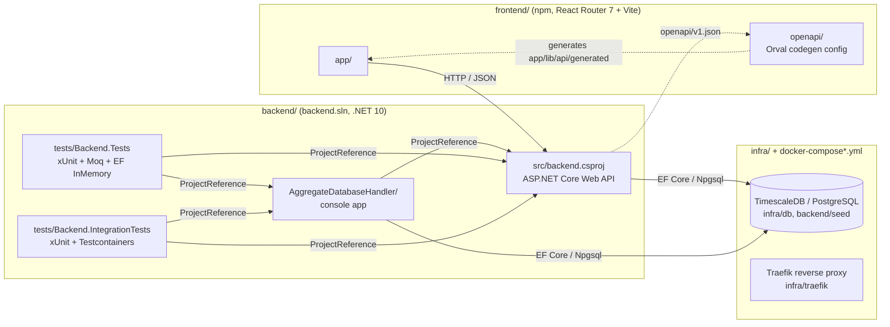
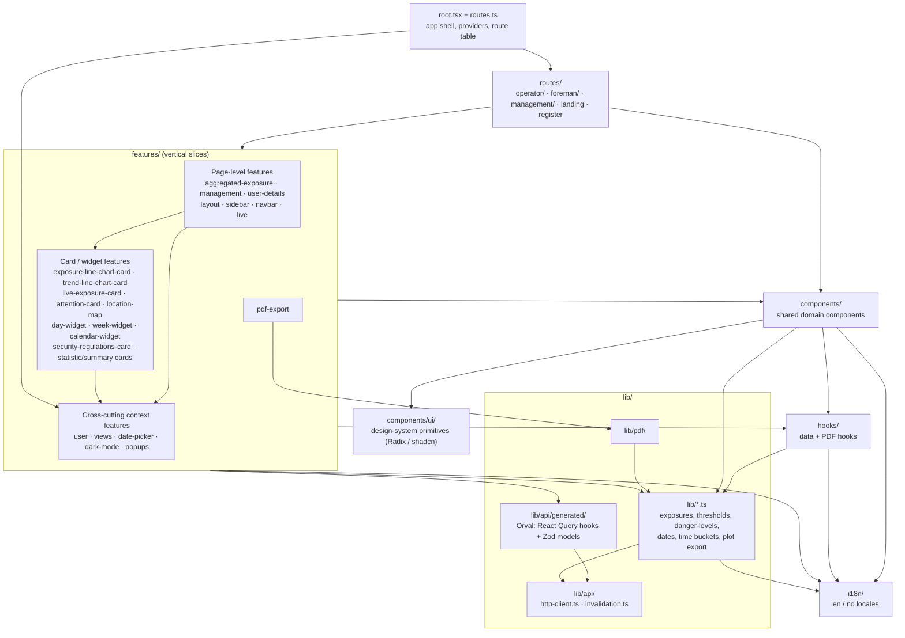
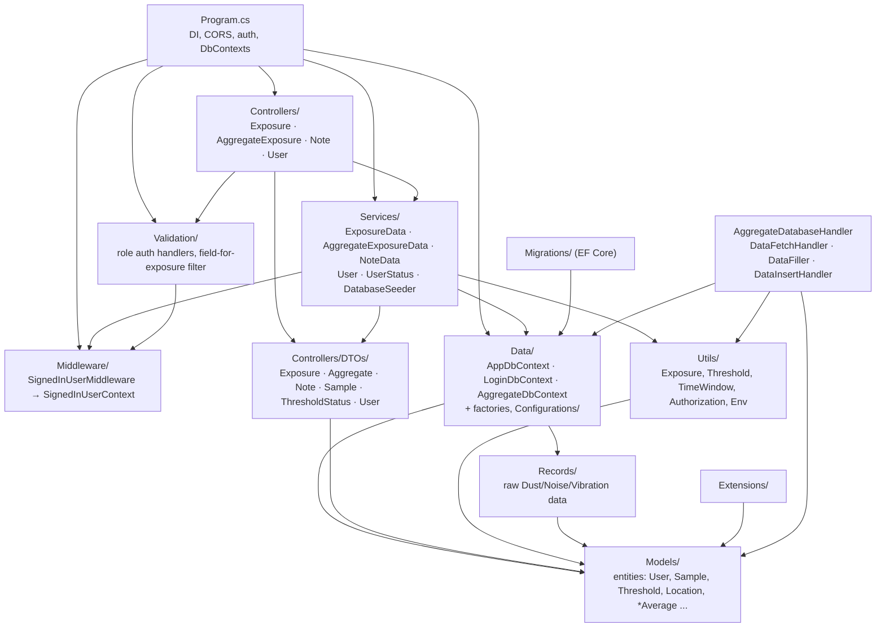
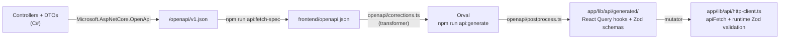

# Development View

The development view (from Kruchten's 4+1 view model) describes how the **source code is organised**: the build units, the modules inside them, and the dependencies between them. It is the map a developer needs to know *where code lives* and *which way dependencies are allowed to point*.

The diagrams below were derived from the actual imports (frontend) and type references (backend) in the codebase, not just the folder names. Arrows mean "depends on / imports".

## 1. Build units

The repository contains five independently built units, connected by project references, a generated API contract, and a shared database.

| Unit | Path | Type | Purpose |
|---|---|---|---|
| Frontend | `frontend/` | React Router 7 SPA (TypeScript) | Dashboards for operators, foremen and management |
| Backend API | `backend/src/` | ASP.NET Core Web API | REST API for exposure, aggregate, note and user data |
| Aggregate handler | `backend/AggregateDatabaseHandler/` | .NET console app | Pre-computes aggregated exposure data into the aggregate database. Reuses the API project's `Data`, `Models` and `Utils` |
| Unit tests | `backend/tests/Backend.Tests/` | xUnit | Services, controllers and utilities against EF InMemory or mocks |
| Integration tests | `backend/tests/Backend.IntegrationTests/` | xUnit + Testcontainers | Services against a real PostgreSQL container |
| Infrastructure | `infra/`, `docker-compose*.yml` | Docker, Traefik | Local database and production deployment |

CI is split per unit in `.github/workflows/` (`frontend-ci.yml`, `backend-ci.yml`, `deploy.yml`).

## 2. Frontend module structure

`frontend/app/` follows a **routes → features → shared** layering. Path aliases (`@/features`, `@/components`, `@/ui`, `@/hooks`, `@/lib`, `@/i18n`) are defined in `frontend/tsconfig.json`.

### Feature dependencies (measured)

The most connected features, by number of imports from other features:

| Feature | Depends on |
|---|---|
| `user-details` | `date-picker`, `day-widget`, `week-widget`, `exposure-line-chart-card`, `trend-line-chart-card`, `views`, statistic cards |
| `layout` | `user`, `popups`, `views`, `date-picker`, `dark-mode` |
| `exposure-line-chart-card` | `calendar-widget`, `week-widget`, statistic cards |
| `aggregated-exposure` | `location-map`, `views`, statistic cards |
| `management` | `aggregated-exposure` |
| `pdf-export` | `exposure-line-chart-card`, `user`, `views` + `lib/pdf` |

`user`, `views` and `date-picker` behave as **application-wide context**: almost everything reads the current user, the selected view (day/week/month) and the selected date from them.

## 3. Backend module structure

`backend/src/` is a classic layered ASP.NET Core project. Namespaces are `Backend.*`.

Three databases are reached through separate `DbContext`s:

| DbContext | Config key | Holds |
|---|---|---|
| `AppDbContext` | `DATABASE_URL` | Operational exposure samples, notes, thresholds |
| `LoginDbContext` | `LOGIN_DATABASE_URL` | Users and roles |
| `AggregateDbContext` | `AGGREGATE_DATABASE_URL` | Pre-aggregated data written by `AggregateDatabaseHandler` |

## 4. API contract pipeline

The frontend never hand-writes request code for the backend. The contract flows from the C# controllers to a typed client:

`npm run api:check` regenerates the client and fails if it differs from the committed version, so a backend contract change that wasn't regenerated is caught in CI.

## 5. Dependency rules

These are the intended rules. The "Current exceptions" column lists the places where the code breaks a rule today.

| Rule | Current exceptions |
|---|---|
| **FE-1** `components/`, `hooks/` and `lib/` must not import from `features/` | `components/notes-card.tsx`, `components/notifications.tsx` → `features/user`, `views`, `date-picker` `components/exposure-level-card.tsx` → `features/attention-card` `hooks/use-exposure-chart-data.ts`, `hooks/use-exposure-trend-data.ts` → `features/user`, `views`, `date-picker`, `trend-line-chart-card` `hooks/use-export-pdf.ts` → `features/pdf-export` `lib/utils.ts`, `lib/api/http-client.ts` → `features/user` |
| **FE-2** `components/ui/` is pure presentation and imports nothing app-specific | None |
| **FE-3** Backend calls go through `lib/api/generated`, never raw `fetch` | None |
| **BE-1** Controllers → Services → Data. Controllers don't touch `DbContext` directly | None |
| **BE-2** `Models/` and `Data/` must not depend on `Controllers/DTOs` or `Services` | `Models/Threshold.cs` uses `Field` (DTOs) `Data/RequestContext.cs` uses `ExposureDataRequestDto` `Data/*DbContextFactory.cs` use `Services/DatabaseSeeder` |
| **BE-3** `Utils/` depends only on `Models/` | `Utils/ExposureUtils.cs`, `Utils/ThresholdUtils.cs` use `Field`, `TimeGranularity`, `AggregationFunction` (DTOs) |
| **BE-4** DTOs depend only on `Models/` | `UserDTOs/FullUserDto.cs` uses `FullUser` (defined in `Services/UserService.cs`) |

Most of these exceptions come from two sources, which can be fixed cheaply:

- **Frontend:** the user, view and date contexts are global app state but live in `features/`. Moving them to a shared location such as `app/context/` removes nearly all FE-1 violations.
- **Backend:** the enums `Field`, `TimeGranularity` and `AggregationFunction` are domain concepts but are declared inside `ExposureDataRequestDto.cs`. Moving them to `Models/` removes most BE-2 and BE-3 violations, and lets `AggregateDatabaseHandler` stop depending on the DTO namespace.

## 6. Keeping this view up to date

- Update the diagrams when a build unit, top-level folder or feature is added or removed.
- To enforce the rules automatically, consider:
  - Frontend: [`dependency-cruiser`](https://github.com/sverweij/dependency-cruiser) with a `forbidden` rule for `^app/(components|hooks|lib)` → `^app/features`. It can also generate the import graph (`depcruise app --output-type mermaid`).
  - Backend: [NetArchTest](https://github.com/BenMorris/NetArchTest) rules in `Backend.Tests` (for example, types in `Backend.Models` must not depend on `Backend.Controllers`).
